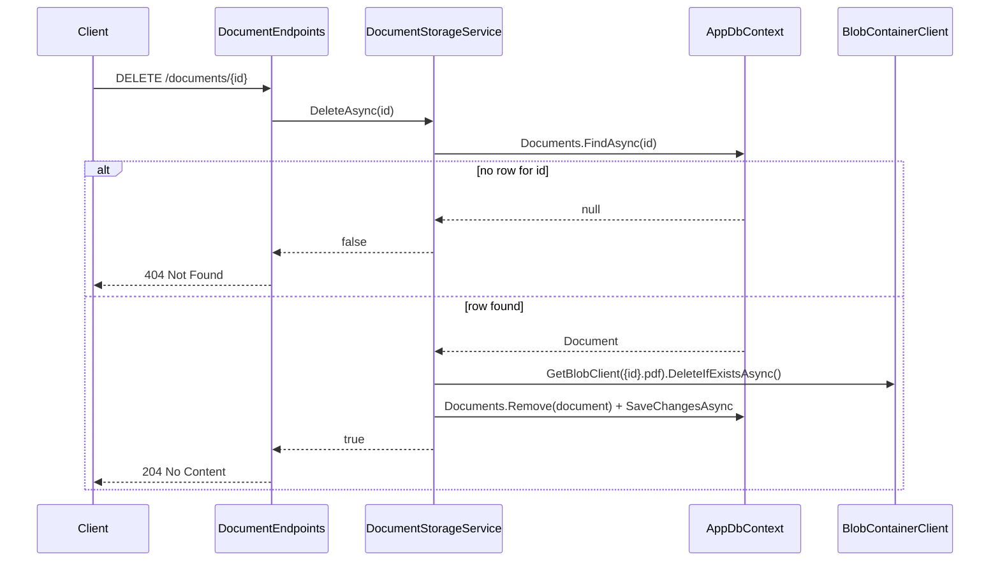

# DELETE /documents/{id} — Delete a Document

## Goal

Round out CRUD support: let a caller remove a document's metadata row *and* its underlying blob.

## Design



### Ordering: blob delete before DB delete

Deletes the blob first, then removes the DB row, so a failure partway through never leaves the system worse than it already handles elsewhere:

- If the blob delete throws, the DB row is untouched — the document still "exists" from the API's point of view (consistent, retryable).
- If the DB delete throws *after* the blob is already gone, the leftover row just becomes a document whose `download` already 404s (the existing "orphaned blob" handling in `DownloadAsync` covers this) — a recoverable degraded state, not a broken one.

Uses `DeleteIfExistsAsync` (not `DeleteAsync`) so a document whose blob is already missing (e.g. previously orphaned) can still be deleted cleanly instead of throwing.

### `IDocumentStorageService` — new method

```csharp
/// <returns><see langword="true"/> if a document was found and deleted, <see langword="false"/> if no document exists for <paramref name="id"/>.</returns>
Task<bool> DeleteAsync(Guid id, CancellationToken cancellationToken = default);
```

### Endpoint

`DELETE /documents/{id:guid}` → `204 No Content` on success, `404 Not Found` if the id doesn't exist, `500`-mapped `Problem` on unexpected errors (same shape as the other handlers).

## Tests to add

- **Services**: `DeleteAsync` returns `false` for an unknown id (no blob call attempted); returns `true` and removes the row + calls blob delete for an existing document; doesn't throw when the blob is already missing.
- **Endpoints**: `DeleteDocumentAsync` returns `204` when the service reports success, `404` when it reports not-found, `500`-mapped `Problem` when the service throws.

## Verification

- [ ] `dotnet build` succeeds
- [ ] `dotnet test` passes
- [ ] Live: upload a document, `DELETE` it → `204`; `GET /documents` no longer lists it; `GET /documents/{id}/download` now `404`; deleting the same id again → `404`

## Out of scope

- Soft delete / recovery window
- Cascading delete of related resources (none exist yet)
