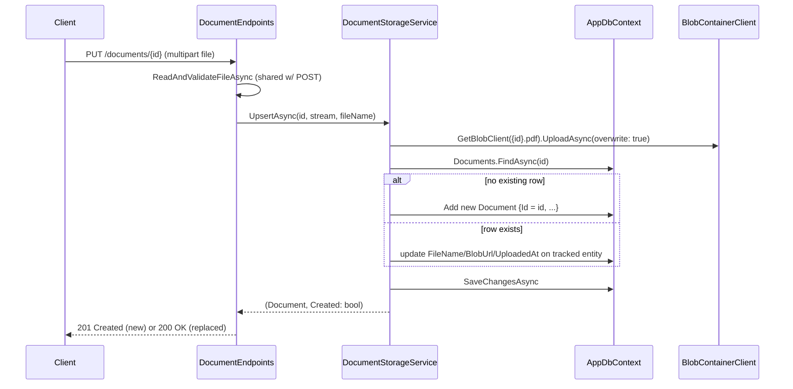

# PUT /documents/{id} — Upsert a Document's File

## Goal

Let a caller replace the file behind an existing document (e.g. re-uploading a corrected version), or create a document at a caller-chosen id, via standard PUT-as-upsert semantics. Accepts the file the same way `POST /documents` does — `multipart/form-data` with a `file` field — so it works from a browser file picker or Postman form-data exactly like the existing upload endpoint.

## Decisions (confirmed)

- **Identity**: `PUT /documents/{id}` — the client supplies the `id`. If a row with that `id` exists, its file + metadata are replaced. If not, a new row is created with that exact `id` (true upsert, idiomatic PUT semantics).
- **FileName**: updates to match the newly uploaded file's name on every PUT (create or replace).
- **UploadedAt**: refreshed to `UtcNow` on every PUT (acts as "last modified"). No schema change — existing single timestamp column is reused rather than adding a separate `UpdatedAt` column.
- **Response code**: `201 Created` when the PUT created a new row (mirrors `POST`'s response), `200 OK` when it replaced an existing one.

## Design



### `IDocumentStorageService` — new method

```csharp
Task<(Document Document, bool Created)> UpsertAsync(
    Guid id, Stream pdfStream, string fileName, CancellationToken cancellationToken = default);
```

`UploadAsync` (used by `POST`) becomes a thin wrapper: `UpsertAsync(Guid.NewGuid(), ...)` — a brand-new server-generated id is always a "create", so this removes duplicated blob-upload/save logic between the two paths (DRY).

Blob naming is unaffected by the upsert: since only PDFs are accepted, the blob name is always `{id}.pdf`, so replacing a document's file overwrites the same blob in place — no orphaned blobs to clean up.

### Endpoint layer

- Extract the existing "read multipart form + validate file" logic out of `PostDocumentAsync` into a shared private helper (`ReadAndValidateFileAsync`), reused by the new `PutDocumentAsync`. Pure refactor of `POST` — no behavior change, existing tests keep passing unmodified.
- `PUT /documents/{id:guid}` → `PutDocumentAsync(Guid id, HttpContext, ILoggerFactory)`, mirroring `PostDocumentAsync`'s structure (lazy `IDocumentStorageService` resolution, try/catch → `500` on unexpected errors).

## Tests to add

- **Services**: `UpsertAsync` creates a new row (with the given id) when none exists; replaces `FileName`/`BlobUrl`/`UploadedAt` on the existing row (same `Id`) when one does; overwrites the blob at the same blob name in both cases.
- **Endpoints**: `PutDocumentAsync` returns `400` for the same invalid-file cases as `POST` (no form, missing file, non-PDF); returns `201 Created` when the service reports a new row; returns `200 OK` when it reports a replacement; returns `500`-mapped `Problem` when the service throws.

## Verification

- [ ] `dotnet build` succeeds
- [ ] `dotnet test` passes
- [ ] Live: `PUT /documents/{new-guid}` with a PDF → `201`, document appears in `GET /documents`
- [ ] Live: `PUT /documents/{same-guid}` again with a different PDF → `200`, `GET /documents/{id}/download` returns the *new* file's bytes

## Out of scope

- Optimistic concurrency (`ETag`/`If-Match`) on the replace path
- Deleting/garbage-collecting the previous blob version (not needed since the blob name is stable per id)
