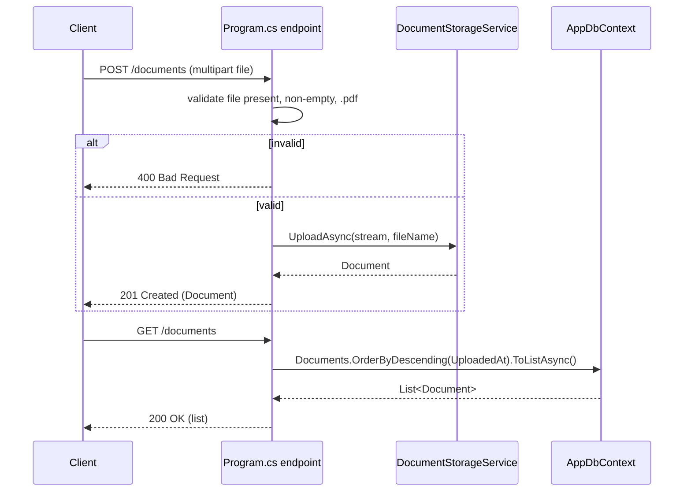

# POST /documents + GET /documents Minimal API Endpoints

## Goal

Add two Minimal API endpoints directly in [`Program.cs`](D:\Projects\Learn\PDF-Operator\NETCore-PDF-Service\Program.cs), wiring together the pieces already built:

- `POST /documents` — accepts a file upload, calls [`DocumentStorageService`](D:\Projects\Learn\PDF-Operator\NETCore-PDF-Service\Services\DocumentStorageService.cs) (blob upload + metadata save), returns the created record.
- `GET /documents` — returns all `Document` rows from [`AppDbContext`](D:\Projects\Learn\PDF-Operator\NETCore-PDF-Service\Data\AppDbContext.cs), ordered by `UploadedAt` descending.

Includes basic error handling for missing/invalid files on the upload path. No controllers, no DTOs, no separate endpoint-mapping file — matches the existing minimal, single-file `Program.cs` style used so far.

## Current state

- `DocumentStorageService.UploadAsync(Stream, string)` already does blob upload + `Document` row save in one call.
- `AppDbContext.Documents` is the queryable `DbSet<Document>`.
- `Program.cs` currently only has `app.MapGet("/", ...)` — the scaffold's default route.

## Design



### `POST /documents`

```csharp
app.MapPost("/documents", async (IFormFile? file, DocumentStorageService storageService) =>
{
    if (file is null || file.Length == 0)
    {
        return Results.BadRequest(new { error = "A non-empty file is required." });
    }

    var isPdf = string.Equals(file.ContentType, "application/pdf", StringComparison.OrdinalIgnoreCase)
        || string.Equals(Path.GetExtension(file.FileName), ".pdf", StringComparison.OrdinalIgnoreCase);

    if (!isPdf)
    {
        return Results.BadRequest(new { error = "Only PDF files are supported." });
    }

    try
    {
        await using var stream = file.OpenReadStream();
        var document = await storageService.UploadAsync(stream, file.FileName);
        return Results.Created($"/documents/{document.Id}", document);
    }
    catch (Exception ex)
    {
        app.Logger.LogError(ex, "Failed to upload document {FileName}", file.FileName);
        return Results.Problem("Failed to upload document.", statusCode: StatusCodes.Status500InternalServerError);
    }
})
.DisableAntiforgery();
```

Validation covered:

- **Missing file** (`file is null`) → `400`
- **Empty file** (`file.Length == 0`) → `400`
- **Wrong file type** (not PDF by content-type or extension) → `400`
- **Upload/DB failure** (e.g. Azurite unreachable) → caught, logged, `500` via `Results.Problem`

Notes:

- `IFormFile?` binds directly from `multipart/form-data` in Minimal APIs (.NET 7+) — no `[FromForm]` attribute or a request DTO needed.
- `.DisableAntiforgery()` is required for file-upload-bound Minimal API endpoints when the antiforgery middleware is active; harmless no-op if it isn't configured, but keeps this endpoint forward-compatible if antiforgery is added later.
- Returns `201 Created` with a `Location` header pointing at `/documents/{id}` even though a matching `GET /documents/{id}` endpoint doesn't exist yet (noted as out of scope below) — this is standard REST practice and cheap to add now.
- No manual `Content-Length`/size-limit check added; relies on Kestrel/ASP.NET Core's default multipart body size limits. Out of scope to customize.

### `GET /documents`

```csharp
app.MapGet("/documents", async (AppDbContext db) =>
{
    var documents = await db.Documents
        .OrderByDescending(d => d.UploadedAt)
        .ToListAsync();

    return Results.Ok(documents);
});
```

- No pagination, filtering, or DTO projection — returns the `Document` entities directly, matching the architecture doc's original two-endpoint design.
- No try/catch here; unhandled exceptions (e.g. SQLite file locked) fall through to the framework's default developer exception page / 500 response, consistent with not over-engineering error handling on the read path per your ask ("basic error handling for missing/invalid files" — scoped to the upload path).

### Where these go in `Program.cs`

Both `app.MapPost`/`app.MapGet` calls are added after `db.Database.Migrate()` and can replace or sit alongside the existing `app.MapGet("/", ...)` placeholder route.

## Verification

- [ ] `dotnet build` succeeds
- [ ] `POST /documents` with no file → `400` with an error message
- [ ] `POST /documents` with a non-PDF file → `400` with an error message
- [ ] `POST /documents` with a valid PDF (Azurite running) → `201`, blob appears in the `documents` container, row appears in `Documents` table
- [ ] `GET /documents` → `200` with a JSON array ordered newest-first

## Out of scope (follow-up work, not this plan)

- `GET /documents/{id}` single-document lookup endpoint
- Request size limit configuration for large PDFs
- DTOs / response shaping (currently returns `Document` entities directly)
- Authentication/authorization
- Automated tests
