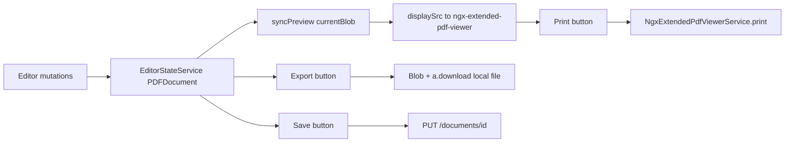

# Phase 5 — Export (local save) and Print

## Context

Phase 4 already serializes the in-memory `PDFDocument` via [`EditorStateService.exportAsFile()`](D:\Projects\Learn\PDF-Operator\Angular-PDF-App\src\app\services\editor-state.service.ts) for **Save** (`PUT` through `DocumentService.replaceDocument`). Extract-page already uses the Blob + temporary `<a download>` pattern in [`EditorPanelComponent.extractPage()`](D:\Projects\Learn\PDF-Operator\Angular-PDF-App\src\app\editor-panel\editor-panel.ts).

`ngx-extended-pdf-viewer` exposes `NgxExtendedPdfViewerService.print()`, which drives pdf.js's print path into the browser's native print dialog against the currently rendered document (`displaySrc` — includes unsaved edits once edit mode has loaded the Blob).

## Defaults (committed)

- **Export** lives in the editor panel footer next to **Save** (edit mode only). That matches "serialize the current pdf-lib `PDFDocument`" — the document only exists after `loadFromBlob` in edit mode. Filename = the same `fileName` input used by Save (original `Document.fileName`).
- **Print** lives on the viewer toolbar next to "Edit mode", available whenever a PDF is loaded (view or edit). Implemented via `NgxExtendedPdfViewerService.print()` rather than raw `window.print()` so the dialog prints the PDF pages, not the Angular chrome. Do **not** also enable `[showPrintButton]` on the viewer (would duplicate the control).
- No backend changes.



## 1. Shared download helper

Add [`src/app/shared/download-blob.ts`](D:\Projects\Learn\PDF-Operator\Angular-PDF-App\src\app\shared\download-blob.ts):

```ts
export function downloadBlob(blob: Blob, fileName: string): void {
  const url = URL.createObjectURL(blob);
  const link = document.createElement('a');
  link.href = url;
  link.download = fileName;
  link.click();
  URL.revokeObjectURL(url);
}
```

Refactor `EditorPanelComponent.extractPage()` to use it (same behavior, less duplication with Export).

## 2. Export button (local only)

In [`editor-panel.ts`](D:\Projects\Learn\PDF-Operator\Angular-PDF-App\src\app\editor-panel\editor-panel.ts) / [`.html`](D:\Projects\Learn\PDF-Operator\Angular-PDF-App\src\app\editor-panel\editor-panel.html) / [`.css`](D:\Projects\Learn\PDF-Operator\Angular-PDF-App\src\app\editor-panel\editor-panel.css):

- Add `exportLocal()`: `await editorState.exportAsFile(this.fileName)` then `downloadBlob(file, fileName)`. No `DocumentService` call.
- Place an **Export** button beside **Save** in `.editor-panel__save`. Visually distinct (outline/secondary) so Save remains the primary server action.
- Disable while `isSaving()` or `editorState.isBusy()`; surface a short local error string if export fails (no HTTP helper needed).

## 3. Print button

In [`viewer.ts`](D:\Projects\Learn\PDF-Operator\Angular-PDF-App\src\app\viewer\viewer.ts) / [`.html`](D:\Projects\Learn\PDF-Operator\Angular-PDF-App\src\app\viewer\viewer.html) / [`.css`](D:\Projects\Learn\PDF-Operator\Angular-PDF-App\src\app\viewer\viewer.css):

- Inject `NgxExtendedPdfViewerService`.
- Add `printDocument()` → `this.pdfViewerService.print()`.
- Add a **Print** button in `.viewer-toolbar` next to the Edit-mode toggle, shown when `displaySrc()` is ready (same condition as Edit mode).
- Style consistently with `.edit-toggle`.

## 4. Manual validation

1. Open a multi-page PDF, enter Edit mode, make a visible edit (e.g. rotate).
2. Click **Export** — browser downloads a PDF; open it outside the app and confirm the edit is present. Confirm Network tab shows **no** `PUT` for Export.
3. Click **Save** separately and confirm it still `PUT`s as before (regression check).
4. Click **Print** (view or edit mode) — native print dialog opens with the rendered PDF pages (including live edits if already editing).
5. `ng build` still succeeds within the existing 2MB/3MB budget; `dotnet test` still passes (no backend changes).

## Out of scope

- Server-side export endpoints
- Print range / page-subset UI (`print()` accepts an optional range — not needed for MVP)
- Enabling the library's built-in download/print toolbar buttons (would duplicate Export/Print)
