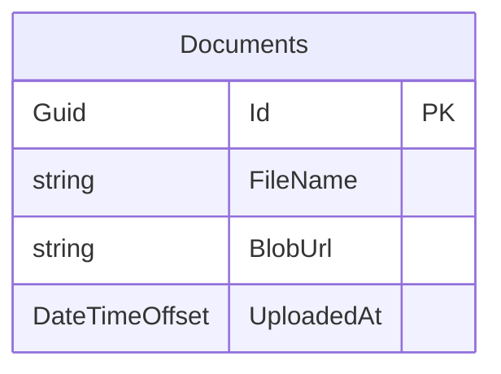
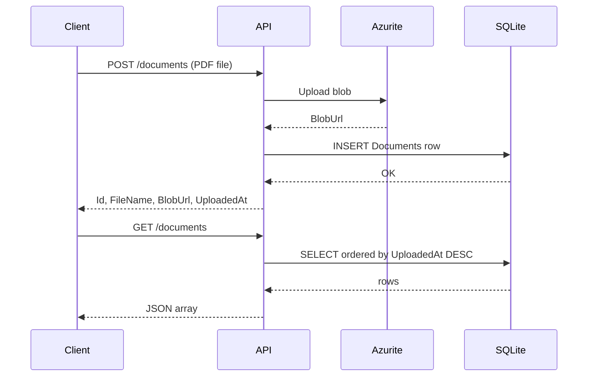

# SQLite Document Metadata Schema (EF Core Code First)

## Goal

One SQLite table stores **document metadata only** (not PDF bytes). Blobs live in Azurite; the API reads/writes rows via EF Core Code First, with migrations committed to git.

---

## Schema

### Table: `Documents`

| Column | CLR type | SQLite type | Constraints | Notes |
|---|---|---|---|---|
| `Id` | `Guid` | `TEXT` | PK, NOT NULL | Opaque ID returned by `POST /documents` |
| `FileName` | `string` | `TEXT` | NOT NULL, max 512 | Original upload name |
| `BlobUrl` | `string` | `TEXT` | NOT NULL, max 2048 | Full blob URI from Azurite |
| `UploadedAt` | `DateTimeOffset` | `TEXT` (ISO-8601) | NOT NULL | UTC at insert time |

### Design decisions

- **Single table, no navigation properties** — matches the two-endpoint API (`POST /documents`, `GET /documents`).
- **`Guid` PK** — stable, opaque IDs for the API without exposing row order.
- **`DateTimeOffset` for `UploadedAt`** — EF Core maps cleanly to SQLite `TEXT`; always store UTC.
- **No unique index on `FileName`** — same filename can be uploaded more than once.
- **Optional index on `UploadedAt DESC`** — cheap win for `GET /documents` ordered by newest first (can be in the initial migration or a follow-up).



---

## Project layout (where things live)

Since `NETCore-PDF-Service` is greenfield, organize like this:

```
NETCore-PDF-Service/
├── NETCore-PDF-Service.csproj
├── Program.cs
├── appsettings.json
├── appsettings.Development.json
├── Data/
│   ├── AppDbContext.cs
│   └── Configurations/
│       └── DocumentConfiguration.cs   # optional IEntityTypeConfiguration
├── Models/
│   └── Document.cs
└── Migrations/
    ├── <timestamp>_InitialCreate.cs
    ├── <timestamp>_InitialCreate.Designer.cs
    └── AppDbContextModelSnapshot.cs
```

Runtime DB file (not a migration artifact):

```
NETCore-PDF-Service/data/app.db
```

---

## EF Core packages

Add to the web project:

| Package | Purpose |
|---|---|
| `Microsoft.EntityFrameworkCore.Sqlite` | SQLite provider |
| `Microsoft.EntityFrameworkCore.Design` | CLI migrations (PrivateAssets) |

Optional for dev convenience:

| Package | Purpose |
|---|---|
| `Microsoft.EntityFrameworkCore.Tools` | `dotnet ef` from Package Manager / local tool manifest |

Target: **.NET 8** Minimal API (matches the architecture doc).

---

## Entity & DbContext (conceptual — no code yet)

### `Document` entity

- Properties: `Id`, `FileName`, `BlobUrl`, `UploadedAt`
- `Id` set in application code on insert (not DB-generated)
- No base class, no soft-delete, no audit columns beyond `UploadedAt`

### `AppDbContext`

- One `DbSet<Document> Documents`
- Configure in `OnModelCreating` (or `DocumentConfiguration`):
  - Table name: `Documents`
  - PK: `Id`
  - `FileName`: required, max 512
  - `BlobUrl`: required, max 2048
  - `UploadedAt`: required
  - Optional: index on `UploadedAt`

### Connection string

In `appsettings.Development.json`:

```json
"ConnectionStrings": {
  "DefaultConnection": "Data Source=data/app.db"
}
```

Ensure `data/` exists at startup (or use `EnsureCreated` only in dev — prefer migrations).

---

## Migration workflow

### One-time setup

1. Create the Minimal API project under `NETCore-PDF-Service/`.
2. Add EF Core packages.
3. Add `Document`, `AppDbContext`, and register `AppDbContext` in `Program.cs`.
4. Install EF CLI (global or local tool): `dotnet tool install dotnet-ef`.
5. Generate the first migration:

   ```bash
   dotnet ef migrations add InitialCreate --output-dir Migrations
   ```

6. Apply locally:

   ```bash
   dotnet ef database update
   ```

### What gets checked into source control

| Path | Commit? | Why |
|---|---|---|
| `Migrations/*.cs` | **Yes** | Schema history; reproducible across machines/CI |
| `Models/Document.cs` | **Yes** | Source of truth with migrations |
| `Data/AppDbContext.cs` | **Yes** | DbContext + configuration |
| `data/app.db` | **No** (gitignore) | Runtime artifact; recreated via `database update` |
| `Migrations/` folder structure | **Yes** | Required for Code First |

Add to `.gitignore`:

```
data/
*.db
*.db-shm
*.db-wal
```

The architecture doc mentions checking SQLite into source control for zero-setup dev — that applies to **migrations**, not the live `.db` file. The DB is created on first run.

### Apply migrations at startup (recommended for MVP)

In `Program.cs`, after building the app:

- Resolve `AppDbContext` from a scope
- Call `Database.Migrate()` once on startup

This keeps `dotnet run` working without a manual `database update` step. For production you'd typically run migrations in CI/CD instead.

---

## API integration (how the schema is used)



**`POST /documents`**

1. Upload bytes to Azurite → get `BlobUrl`
2. Insert row: new `Guid`, `FileName`, `BlobUrl`, `UploadedAt = UtcNow`
3. Return the metadata DTO

**`GET /documents`**

1. Query `Documents` ordered by `UploadedAt` descending
2. Project to a lightweight DTO (same four fields)

No update/delete endpoints in MVP → no migration needed for those yet.

---

## Verification checklist (before calling schema done)

- [ ] `dotnet ef migrations add InitialCreate` succeeds
- [ ] `dotnet ef database update` creates `data/app.db` with one `Documents` table
- [ ] Four columns match the plan (types and NOT NULL)
- [ ] `Migrations/` and model files are staged for git
- [ ] `data/*.db` is gitignored
- [ ] Fresh clone + `dotnet run` applies migration and API can insert/list rows

---

## Out of scope (for later migrations)

- Soft delete / `IsDeleted`
- Content hash / file size columns
- User ownership / auth
- Postgres provider swap
- Concurrency token on metadata

---

## Suggested implementation order (when you do write code)

1. Scaffold Minimal API project + EF packages
2. Add `Document` + `AppDbContext` + DI registration
3. Run `InitialCreate` migration and commit `Migrations/`
4. Wire `POST /documents` and `GET /documents` to the DbContext
5. Smoke-test upload → row in SQLite → list returns it
